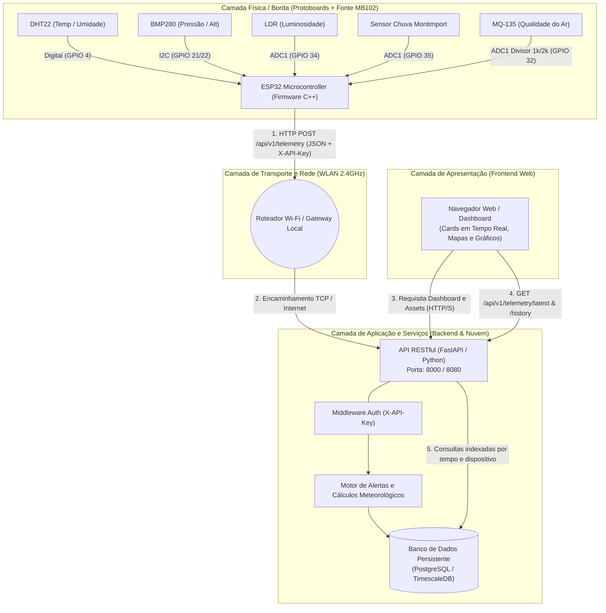

# Arquitetura Geral do Sistema EcoPulse

O projeto **EcoPulse** é uma estação meteorológica inteligente distribuída, projetada com base nos princípios de Internet das Coisas (IoT), computação em borda e arquitetura orientada a serviços RESTful para monitoramento microclimático urbano.

---

## 1. Diagrama de Rede e Arquitetura do Sistema

---

## 2. Detalhamento das Camadas do Sistema

### A. Camada de Borda (Edge / Hardware)
* **Microcontrolador:** ESP32 NodeMCU-32S (Dual-Core Xtensa LX6, 240MHz, 520KB SRAM).
* **Alimentação Dedicada:** Módulo de fonte para protoboard **MB102** com barramentos isolados de **3.3V** e **5.0V**.
* **Sensores Integrados:**
  1. **DHT22 (AM2302):** Medição de temperatura (-40 a 80°C) e umidade relativa (0 a 100%).
  2. **BMP280:** Medição barométrica de alta precisão (300 a 1100 hPa) e estimativa de altitude.
  3. **LDR (Fotoresistor 5mm):** Medição de intensidade luminosa ambiente através de divisor resistivo de 10kΩ.
  4. **MQ-135:** Detecção de gases atmosféricos e qualidade do ar (CO2, fumaça, benzeno). Exige 5V para o elemento de aquecimento interno e divisor resistivo para atenuar o sinal para o ADC.
  5. **Sensor de Chuva Montimport:** Superfície condutiva com placa comparadora LM393 para detecção instantânea de gotas e índice de precipitação.

### B. Camada de Rede (Transporte)
* **Padrão:** Wi-Fi 802.11 b/g/n (2.4 GHz).
* **Protocolo de Aplicação:** HTTP/1.1 sobre TCP/IP.
* **Segurança:** Autenticação por token pré-compartilhado injetado no cabeçalho HTTP (`X-API-Key`).
* **Sincronização Temporal:** Sincronização automática com servidor **NTP** (`pool.ntp.org`) para registro de Epoch Unix Timestamp preciso diretamente na borda.

### C. Camada de Backend (API REST)
* **Framework:** Python com **FastAPI** / **Uvicorn** (arquitetura assíncrona de alta performance).
* **Validação de Dados:** Pydantic schemas garantindo conformidade estrita com o payload da estação.
* **Camada de Negócio e Cálculos:**
  * Cálculo de Sensação Térmica (Índice de Calor / Heat Index via fórmula de Rothfusz).
  * Ponto de Orvalho (Dew Point via aproximação de Magnus-Tetens).
  * Classificação de Qualidade do Ar (AQI) com base nos níveis de tensão e PPM normalizados.
  * Detecção de eventos extremos (chuva repentina, queda brusca de pressão atmosférica indicando tempestades).

### D. Camada de Dados (Persistência)
* **Banco de Dados:** PostgreSQL estruturado para dados de séries temporais com índices em `device_id` e `timestamp`.
* **Retenção e Agregação:** Suporte a consultas históricas consolidadas por hora, dia e semana para rápida renderização gráfica.

### E. Camada de Apresentação (Frontend)
* **Interface Web Responsiva:** Dashboard modular com indicadores em tempo real (velocímetros, gauges e badges de status).
* **Visualização Analítica:** Gráficos interativos de séries temporais (temperatura, umidade, pressão, luminosidade, gases).
* **Geolocalização:** Mapa com indicador de localização da estação meteorológica e raio de cobertura.
