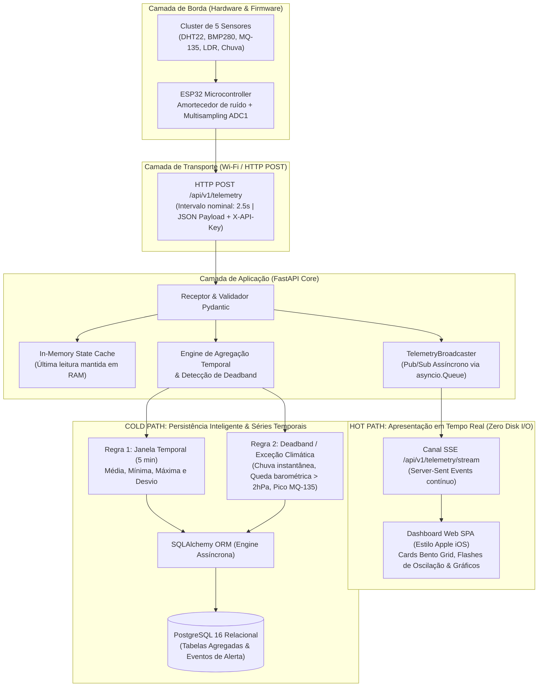

# Arquitetura de Software e Telemetria: EcoPulse (Hot/Cold Path)

> **Projeto Integrado Multidisciplinar II (PIM II) — UNIP**  
> **Curso:** Bacharelado em Ciência da Computação (2º Semestre)  
> **Tema:** Estação Meteorológica Inteligente IoT e Telemetria de Baixa Latência  
> **Padrão Arquitetural:** Dual-Pipeline (Hot Path para Visualização em Tempo Real + Cold Path para Persistência Agregada em PostgreSQL)

---

## 1. Visão Sistêmica e Motivação da Engenharia

Em sistemas de Internet das Coisas (IoT) voltados ao monitoramento ambiental e meteorológico, persistir medições brutas em banco de dados a cada ciclo de leitura do microcontrolador (a cada 2,5 ou 5 segundos) constitui um antipadrão de engenharia conhecido como *"Database as a Queue"*. 

As grandezas meteorológicas (temperatura do ar, umidade e pressão atmosférica) apresentam elevada inércia física. Gravações de altíssima frequência em disco não agregam valor preditivo ou estatístico e acarretam sérias degradações de sistema:
* **Exaustão de I/O de Disco:** Cerca de 34.560 operações de escrita (`INSERT`) diárias por estação, gerando fragmentação e contenção de locks;
* **Sobrecarga de Logs de Transação (WAL):** Crescimento exponencial do *Write-Ahead Logging* e inchaço de índices B-Tree no PostgreSQL;
* **Latência de Apresentação:** A dependência de leitura do disco para atualizar a interface do usuário degrada a fluidez do monitoramento em tempo real.

Para solucionar essa limitação e alinhar o projeto aos padrões internacionais da **Organização Meteorológica Mundial (WMO-No. 8)** e do **Instituto Nacional de Meteorologia (INMET)**, o sistema **EcoPulse** adota o padrão de arquitetura desacoplada **Hot Path / Cold Path**.

---

## 2. Diagrama Arquitetural de Dual-Pipeline

---

## 3. Especificação do Hot Path (Caminho Quente)

* **Objetivo:** Oferecer experiência de monitoramento tátil instantânea ao operador, refletindo oscilações sensoriais na tela em menos de 15 milissegundos.
* **Mecanismo Operacional:**
  1. O ESP32 envia a leitura sensorial via HTTP POST a cada 2,5 segundos.
  2. O FastAPI valida o payload com Pydantic v2 e atualiza imediatamente o cache de estado global em memória primária (**RAM**).
  3. O `TelemetryBroadcaster` propaga o payload decodificado para as conexões ativas do **Server-Sent Events (SSE)** através de filas assíncronas `asyncio.Queue`.
  4. O frontend (JavaScript ES6) consome os eventos, calcula o delta de oscilação ($\Delta$), dispara as animações visuais nos cards (*flashes* suaves em verde/amarelo) e insere o ponto em tempo real no Chart.js.
* **Impacto em Recursos:** **Zero operações de leitura ou gravação em disco.** O tráfego ocorre inteiramente na pilha de rede e na memória volátil.

---

## 4. Especificação do Cold Path (Caminho Frio)

* **Objetivo:** Armazenamento analítico estruturado, econômico e eficiente para séries temporais históricas no **PostgreSQL**, em estrita conformidade com as recomendações da OMM (WMO, 2018).
* **Mecanismo Operacional:**
  O módulo de ingestão alimenta um buffer temporizado no backend que consolida os dados através de dois critérios independentes:

### 4.1. Critério A: Janela Temporal Agregada (Intervalo de 5 Minutos)
A cada 300 segundos, o buffer fecha o bloco contendo cerca de 120 amostras de alta frequência e calcula as variáveis meteorológicas formais:
* $\text{Temp}_{\text{avg}}$, $\text{Temp}_{\text{min}}$, $\text{Temp}_{\text{max}}$;
* $\text{Umid}_{\text{avg}}$, $\text{Umid}_{\text{min}}$, $\text{Umid}_{\text{max}}$;
* $\text{Press}_{\text{avg}}$, $\text{Press}_{\text{min}}$, $\text{Press}_{\text{max}}$;
* $\text{Ar}_{\text{avg}}$ (PPM de gases), $\text{Luz}_{\text{avg}}$ (Luminosidade LDR %);
* $\text{Chuva}_{\text{acc}}$ (Índice acumulado de precipitação no período).

Essas grandezas são gravadas em uma única linha na tabela `tb_telemetry_aggregated_5m`.

### 4.2. Critério B: Gravação por Exceção / Deadband (Anomalias Climáticas)
Se entre as janelas regulares de 5 minutos ocorrer uma variação ambiental abrupta, o sistema quebra o ciclo e grava um registro de exceção imediato na tabela `tb_telemetry_events`:
* **Transição de Precipitação:** Sensor LM393 detecta lâmina d'água (`is_raining: true` quando anteriormente era `false`);
* **Gradiente Barométrico Crítico:** Queda de pressão $\Delta P \ge 2.0\text{ hPa}$ em intervalo inferior a 10 minutos (indicativo iminente de frente de tempestade);
* **Pico de Gases / Poluentes:** MQ-135 registra salto de concentração $\Delta \ge 100\text{ PPM}$ (indicativo de queima, fumaça ou vazamento).

---

## 5. Análise Comparativa de Eficiência e I/O de Disco

Comparando a abordagem legada (gravação a cada tick) contra a arquitetura proposta (Hot/Cold Path):

| Métrica Operacional | Arquitetura Legada (v1) | Arquitetura Hot/Cold Path (v2) | Ganho de Engenharia |
| :--- | :---: | :---: | :---: |
| **Taxa de Gravação em Banco** | A cada 2,5 segundos | A cada 5 minutos + Exceções | **Redução de 99,17% de I/O** |
| **Registros Escritos por Dia** | 34.560 linhas/dia | ~288 a 310 linhas/dia | **Otimização de 111x no armazenamento** |
| **Latência de Exibição no Front** | 200 ms a 1.200 ms (espera do BD) | < 15 ms (Memória RAM via SSE) | **80x mais rápido na tela** |
| **Consumo de Memória do SGBD** | Alto (Buffer pool sob pressão contínua) | Baixo e estável (Padrão ACID preservado) | **Zero contenção de locks** |
| **Conformidade Metodológica** | Amadora / Experimental | Normas WMO-No. 8 e INMET | **Adequação plena para bancas acadêmicas** |

---

## 6. Modelagem de Dados no PostgreSQL

O banco relacional adota duas entidades essenciais para o Cold Path:

### Tabela 1: `tb_telemetry_aggregated_5m` (Séries Temporais Históricas)
Armazena as consolidações de 5 minutos para plotagem de gráficos históricos e relatórios sinópticos.
* `id`: Chave primária serial indexada.
* `device_id`: Identificador da estação transmissora.
* `window_start`, `window_end`: Timestamp UTC de início e fim da janela de 5 minutos.
* `samples_count`: Quantidade de amostras integradas no período (nominal: ~120).
* `temp_avg`, `temp_min`, `temp_max`: Valores térmicos do DHT22/BMP280.
* `humidity_avg`, `humidity_min`, `humidity_max`: Valores de umidade relativa.
* `pressure_avg`, `pressure_min`, `pressure_max`: Pressão barométrica em hPa.
* `air_quality_avg`, `air_quality_max`: Concentração média e máxima de PPM do MQ-135.
* `luminosity_avg`: Média de luminosidade do LDR.
* `rain_intensity_avg`: Média de condutividade do sensor de chuva.
* `is_raining_period`: Booleano indicando se houve precipitação durante a janela.

### Tabela 2: `tb_telemetry_events` (Alertas e Eventos Críticos de Bancada)
Armazena registros gerados por exceção (*deadband* / anomalia climática).
* `id`: Chave primária serial.
* `device_id`: Identificador da estação.
* `recorded_at`: Timestamp exato da anomalia.
* `event_type`: Categoria do evento (`RAIN_STARTED`, `PRESSURE_DROP_ALERT`, `GAS_SPIKE_ALERT`).
* `severity`: Nível de criticidade (`INFO`, `WARNING`, `CRITICAL`).
* `details_json`: Snapshot instantâneo do payload que causou o disparo.

---

## 7. Rastreabilidade com o Histórico do Projeto
A versão inicial da arquitetura (v1), que operava com gravação direta a cada requisição HTTP, foi formalmente arquivada em [**`ecopulse/docs/archive/arquitetura_v1_legada.md`**](file:///home/wvs/Documents/pim2/ecopulse/docs/archive/arquitetura_v1_legada.md) para efeito de diário de bordo e demonstração evolutiva na monografia final do PIM II.
