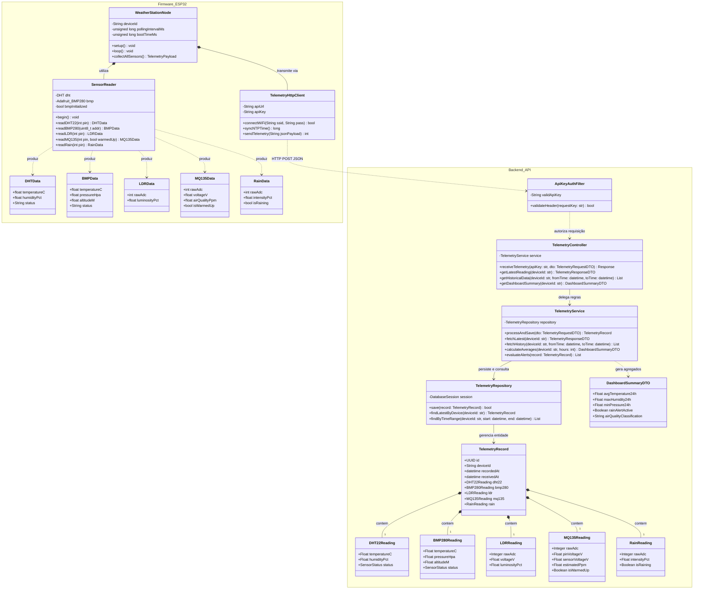

# Diagrama de Classes UML (Firmware & Backend)

Este documento especifica a modelagem orientada a objetos do projeto **EcoPulse**, contemplando a camada de firmware embarcado (C++ no microcontrolador ESP32) e a arquitetura em camadas da API Backend (Python).

---

## 1. Diagrama de Classes Estrutural

---

## 2. Princípios de Design e Responsabilidades

### A. Camada de Firmware (ESP32)
* **`WeatherStationNode` (Orquestrador de Ciclo de Vida):** Controla o tempo de execução não-bloqueante via temporizador com `millis()`, evitando o uso de `delay()` para manter o microcontrolador responsivo a eventos de rede.
* **`SensorReader` (Hardware Abstraction Layer - HAL):** Isola os detalhes de baixo nível dos sensores (endereços I2C, leitura analógica `analogRead()`, canais ADC1). Aplica calibrações de divisores resistivos e normalização de grandezas.
* **`TelemetryHttpClient` (Cliente de Conectividade):** Responsável por estabelecer a conexão Wi-Fi com algoritmo de reconexão exponencial, sincronizar a hora via NTP e disparar requisições POST com tratamento de timeout.

### B. Camada de Backend (API Python)
* **`ApiKeyAuthFilter`:** Middleware de segurança que valida tokens em tempo constante no cabeçalho `X-API-Key`.
* **`TelemetryController`:** Ponto de entrada REST, realiza desserialização e validação de schema via Pydantic.
* **`TelemetryService`:** Contém o núcleo da lógica de negócios: detecção de anomalias, cálculo de médias móveis, classificação de qualidade do ar e disparo de regras de alerta.
* **`TelemetryRepository`:** Isola a camada de persistência em banco de dados através do padrão *Repository Pattern*.
