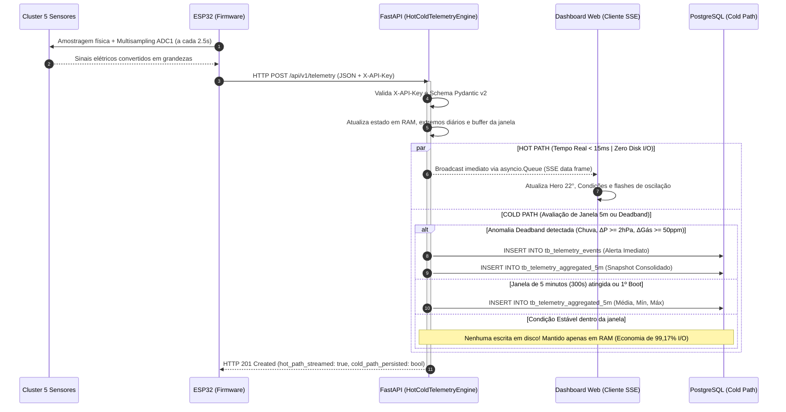
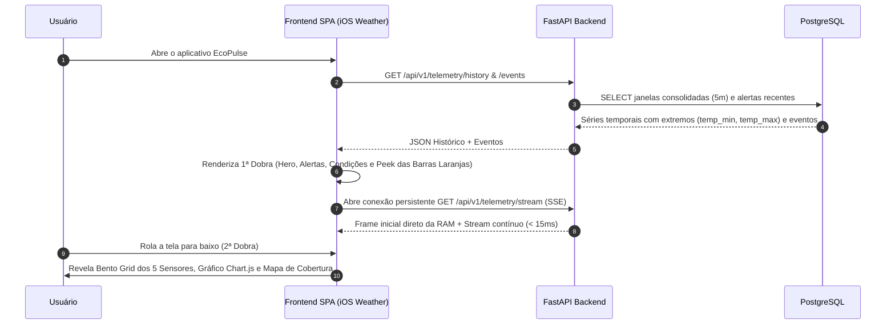

# Diagramas de Sequência do Sistema EcoPulse (Hot/Cold Path)

Os diagramas abaixo ilustram a separação temporal entre o fluxo de baixa latência em memória (**Hot Path**) e a persistência inteligente em janelas e exceções no PostgreSQL (**Cold Path**).

---

## 1. Ingestão Dual-Pipeline (ESP32 $\rightarrow$ Hot Path SSE & Cold Path PostgreSQL)

---

## 2. Inicialização do Dashboard e Transição entre Dobras (iOS Weather UI)

