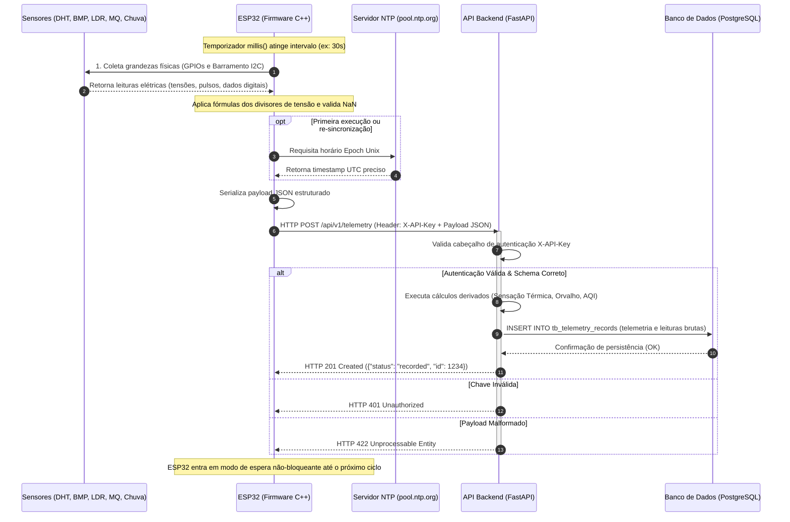
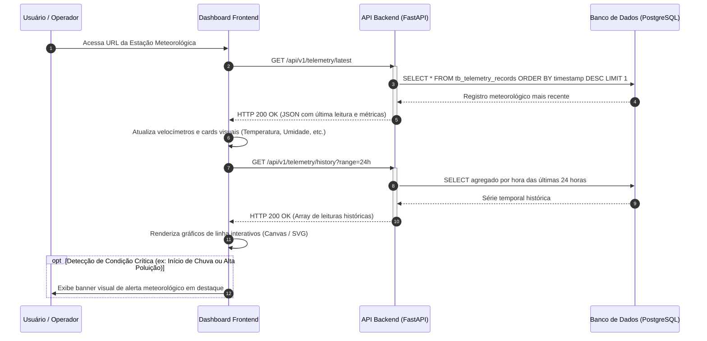
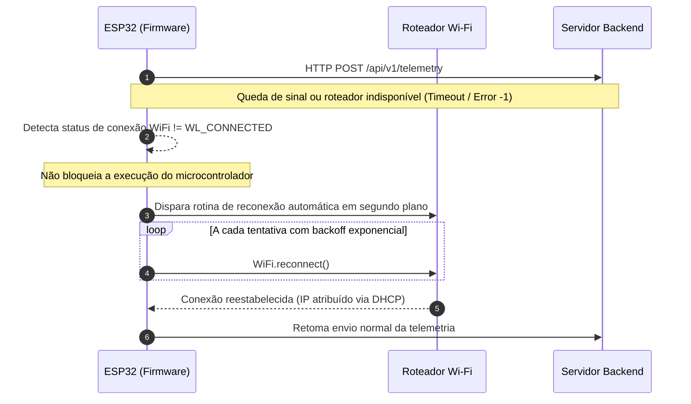

# Diagramas de Sequência do Sistema EcoPulse

Os diagramas de sequência abaixo representam o ciclo de vida temporal dos dados no sistema, detalhando a troca de mensagens síncronas e assíncronas entre os nós da arquitetura.

---

## 1. Ciclo Periódico de Aquisição e Telemetria (ESP32 → Backend)

---

## 2. Ciclo de Consulta e Atualização em Tempo Real (Dashboard Web)

---

## 3. Fluxo de Resiliência e Tolerância a Falhas de Rede

