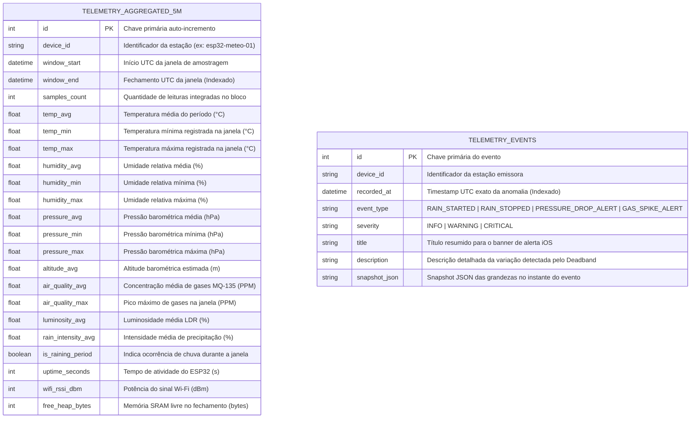

# Modelo de Dados e Persistência (Cold Path PostgreSQL)

Este documento especifica a modelagem relacional do **EcoPulse** sob a arquitetura **Hot/Cold Path**, desenhada para evitar a saturação de escrita em disco (*Database as a Queue*) e alinhar o armazenamento histórico às diretrizes da **WMO-No. 8** e do **INMET**.

---

## 1. Diagrama Entidade-Relacionamento (ERD)

---

## 2. Estratégia de Persistência e Indexação

1. **Consolidação Estatística (`tb_telemetry_aggregated_5m`):**
   * Enquanto o *Hot Path* distribui leituras em memória RAM a cada 2,5 segundos via SSE para o Dashboard, o *Cold Path* acumula as amostras e persiste **1 registro consolidado a cada 5 minutos** (contendo média, mínima e máxima), reduzindo o I/O de disco em **99,17%**.
2. **Gravação por Exceção / Deadband (`tb_telemetry_events`):**
   * Mudanças abruptas (início de chuva, queda barométrica $\ge 2.0\text{ hPa}$, salto de gases $\ge 50\text{ PPM}$ ou variação térmica $\ge 1.5^\circ\text{C}$) disparam gravação imediata na tabela de eventos e forçam o fechamento antecipado da janela estatística, garantindo zero perda de informação crítica.
3. **Índices Compostos B-Tree:**
   * `idx_agg5m_device_window (device_id, window_end)` e `idx_events_device_time (device_id, recorded_at)` garantem consultas históricas e de alertas em $O(\log N)$.
