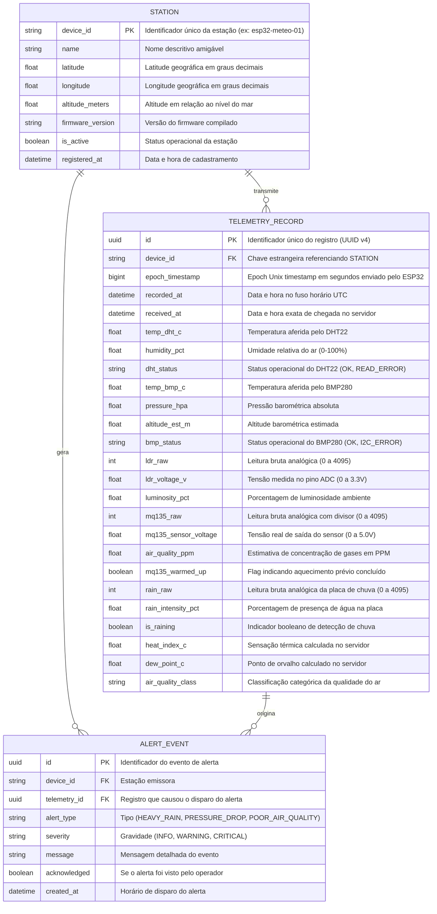

# Modelo de Dados e Persistência

Este documento define a modelagem do banco de dados do sistema **EcoPulse**, projetada para oferecer alta vazão de escrita para séries temporais de sensores IoT e consultas analíticas velozes para o dashboard.

---

## 1. Diagrama Entidade-Relacionamento (ERD)

---

## 2. Estratégia de Indexação e Desempenho

Para assegurar respostas na casa dos milissegundos mesmo com milhões de registros acumulados:
1. **Índice Composto (`device_id`, `recorded_at` DESC):**
   * Essencial para atender a consulta de leitura mais recente (`/telemetry/latest`) com custo $O(1)$.
   * Agiliza a busca de intervalos históricos específicos (`BETWEEN :start AND :end`).
2. **Índice B-Tree em `created_at` na tabela de alertas:**
   * Permite filtrar alertas não resolvidos recentes no topo da barra de notificações do frontend.
3. **Desnormalização Controlada (Flattened Table):**
   * Todas as métricas de um ciclo de leitura são mantidas na mesma linha da tabela `tb_telemetry_records`.
   * Essa escolha evita a necessidade de múltiplos `JOINs` para renderizar uma única tela ou gráfico, reduzindo consumo de memória do banco de dados relacional.
