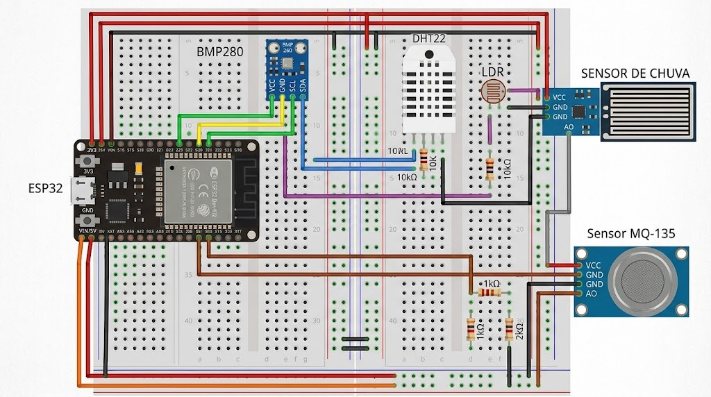

# Especificações de Hardware e IoT - EcoPulse

Este diretório centraliza todas as especificações de engenharia eletrônica, esquemáticos elétricos, cálculos de circuitos passivos e o guia detalhado de montagem da estação meteorológica **EcoPulse**.

---

## 1. Visão Geral da Camada Física (IoT)

A estação adota o microcontrolador **ESP32 NodeMCU-32S** como nó de borda inteligente, responsável pela leitura periódica das grandezas físicas, conversão analógico-digital, cálculo preliminar de parâmetros e transmissão via Wi-Fi.

---

## 2. Lista de Materiais (Bill of Materials - BOM)

| Componente | Quantidade | Função / Finalidade | Nível de Tensão |
| :--- | :---: | :--- | :--- |
| **ESP32 NodeMCU (30 pinos)** | 1 | Microcontrolador central com Wi-Fi 2.4GHz | 3.3V (VCC) / 5V (VIN) |
| **Fonte MB102 p/ Protoboard** | 1 | Fornece barramentos estáveis e isolados | Entrada: 9-12V (Jack DC) ou 5V (USB) |
| **Protoboard 830 pontos** | 2 | Montagem sem necessidade de solda direta | — |
| **Sensor DHT22 (AM2302)** | 1 | Medição de Temperatura e Umidade do ar | 3.3V |
| **Sensor BMP280** | 1 | Pressão atmosférica e estimativa de altitude | 3.3V (I2C) |
| **LDR Fotoresistor 5mm** | 1 | Medição de índice de luminosidade ambiente | 3.3V (ADC) |
| **Sensor MQ-135** | 1 | Detecção de gases atmosféricos e qualidade do ar | 5.0V (Aquecedor) / Saída via Divisor |
| **Sensor de Chuva Montimport** | 1 | Detecção de gotas e intensidade de precipitação | 3.3V (ADC) |
| **Resistor 10 kΩ (1/4W)** | 2 | Pull-up para o DHT22 e Divisor de tensão LDR | — |
| **Resistor 1 kΩ (1/4W)** | 1 | Divisor de tensão para proteção do MQ-135 | — |
| **Resistor 2 kΩ (1/4W)** | 1 | Divisor de tensão para proteção do MQ-135 | — |
| **Cabos Jumpers Macho-Macho** | ~25 | Interligações gerais na protoboard | — |
| **Cabos Jumpers Macho-Fêmea** | ~10 | Conexão para módulos com pinos externos | — |

---

## 3. Estrutura dos Documentos Técnicos

* [**📘 Livreto / Manual de Montagem em PDF (`manual_montagem_ecopulse.pdf`)**](file:///home/wvs/Documents/ccomp-unip/2sem/pim2/ecopulse/hardware/manual_montagem_ecopulse.pdf): Edição diagramada de 8 páginas pronta para visualização no celular ou impressão em laboratório.
* [**Guia de Montagem do Circuito Passo a Passo (`guia_montagem_circuito.md`)**](file:///home/wvs/Documents/ccomp-unip/2sem/pim2/ecopulse/hardware/guia_montagem_circuito.md): Roteiro minucioso para montar os componentes na bancada de forma segura e organizada.
* [**Tabela de Pinout e Conexões (`pinout_conexoes.md`)**](file:///home/wvs/Documents/ccomp-unip/2sem/pim2/ecopulse/hardware/pinout_conexoes.md): Mapeamento pino a pino de todos os periféricos nos GPIOs do ESP32.
* [**Cálculos dos Divisores de Tensão (`calculo_divisores_tensao.md`)**](file:///home/wvs/Documents/ccomp-unip/2sem/pim2/ecopulse/hardware/calculo_divisores_tensao.md): Fórmulas teóricas e justificativas elétricas para proteção das portas analógicas (ADC) do ESP32.
