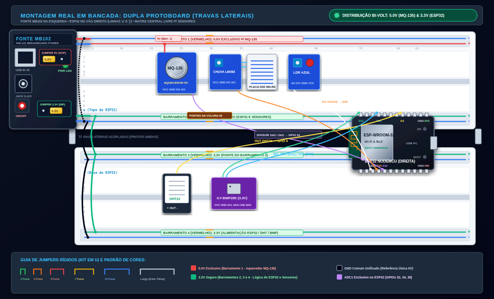

# 📘 Manual Ilustrado de Montagem: Estação Meteorológica IoT com ESP32

Este documento apresenta o guia passo a passo da montagem física da estação **EcoPulse** em bancada, tomando como referência a disposição real em **duas protoboards de 830 pontos acopladas em paralelo pelas travas plásticas laterais**, com a **Fonte MB102 na extremidade esquerda** e o **microcontrolador ESP32 na extremidade direita** (interligando a fileira `a` da placa superior à fileira `j` da placa inferior), mantendo a **área central desobstruída para os sensores**, com aproveitamento do **kit de jumpers rígidos em U**.

Documentos complementares de engenharia:
* [Tabela de Pinout Completa](file:///home/wvs/Documents/ccomp-unip/2sem/pim2/ecopulse/hardware/pinout_conexoes.md)
* [Cálculo Matemático dos Divisores de Tensão](file:///home/wvs/Documents/ccomp-unip/2sem/pim2/ecopulse/hardware/calculo_divisores_tensao.md)
* [Lista de Materiais (BOM)](file:///home/wvs/Documents/ccomp-unip/2sem/pim2/ecopulse/hardware/README.md)
* [Esquemático Ilustrado com Fonte MB102 (PNG)](file:///home/wvs/Documents/ccomp-unip/2sem/pim2/ecopulse/hardware/assets/protoboard_esquematico_mb102.png)
* [Esquemático Vetorial com Fonte MB102 (SVG)](file:///home/wvs/Documents/ccomp-unip/2sem/pim2/ecopulse/hardware/assets/protoboard_esquematico_mb102.svg)

---

## 🖼️ Visão Geral do Circuito com Fonte MB102 Integrada



> [!IMPORTANT]
> **Objetivo Estratégico da Fonte MB102 (Controle Seletivo Bi-Volt):**  
> A fonte MB102 tem como propósito fundamental o **controle independente de voltagem (5V vs 3.3V)** para atender aos diferentes requisitos de cada sensor da bancada:
> 1. **5.0V Regulado (Barramento 1 - Superior):** Alimenta o filamento resistivo de aquecimento do sensor de gases **MQ-135** (que exige 5V contínuos para clivagem química dos gases).
> 2. **3.3V Regulado (Barramentos 2, 3 e 4):** Alimenta a lógica central do microcontrolador **ESP32** e os sensores digitais/analógicos sensíveis (**BMP280**, DHT22, LDR e Chuva), que queimariam sob 5V.
> 3. **GND Comum Unificado:** Todos os trilhos negativos estão interligados por jumpers pretos, mantendo um referencial elétrico único de 0V para leituras analógicas (ADC) estáveis.

---

## 🛠️ 1. Topografia das Coordenadas e Trilhos de Alimentação

Considere as duas protoboards de 830 pontos acopladas horizontalmente pelas travas plásticas laterais (Superior e Inferior):

```text
[FONTE MB102 - ESQUERDA]                                                    [ESP32 - DIREITA]
+-------------------------------------------------------------------------------------------+
| [-] Linha Azul: GND Comum                                                                 |
| [+] Linha Vermelha: BARRAMENTO 1 -> 5.0V EXCLUSIVO P/ MQ-135 (Jumper MB102 em 5V)         |
+-------------------------------------------------------------------------------------------+
|  Protoboard Superior: Fileiras 'j' a 'f' | Colunas 1 a 63                                 |
|  ==================== Canal Central Divisório ====================                        |
|  Protoboard Superior: Fileiras 'e' a 'b' (Livres) | Fileira 'a' (Pinos Sup. ESP32: 48-62) |
+-------------------------------------------------------------------------------------------+
| [+] Linha Vermelha: BARRAMENTO 2 -> 3.3V SEGURO (Jumper MB102 em 3.3V)                    |
| [-] Linha Azul: GND Comum                                                                 |
+===========================================================================================+
| [== TRAVAS LATERAIS ENCAIXADAS UNINDO AS DUAS PROTOBOARDS ==]                             |
+===========================================================================================+
| [+] Linha Vermelha: BARRAMENTO 3 -> 3.3V (Ponte vinda do Barramento 2)                    |
| [-] Linha Azul: GND Comum                                                                 |
+-------------------------------------------------------------------------------------------+
|  Protoboard Inferior: Fileira 'j' (Pinos Inf. ESP32: 48-62) | Fileiras 'i' a 'f' (Livres) |
|  ==================== Canal Central Divisório ====================                        |
|  Protoboard Inferior: Fileiras 'e' a 'a' | Colunas 1 a 63                                 |
+-------------------------------------------------------------------------------------------+
| [+] Linha Vermelha: BARRAMENTO 4 -> 3.3V (Alimentação BMP280 / DHT22)                     |
| [-] Linha Azul: GND Comum                                                                 |
+-------------------------------------------------------------------------------------------+
```

> [!WARNING]
> **Atenção Crítica: Pontes da Coluna 30 nas Protoboards de 830 Pontos**  
> As trilhas de alimentação laterais possuem uma **interrupção física interna bem no centro** (entre as colunas 30 e 33).  
> **Ação obrigatória:** Insira jumpers rígidos em U (de 3 a 5 furos, cores laranja ou vermelha) unindo a metade esquerda à metade direita em todos os barramentos utilizados (1, 2, 3 e 4). Sem essas pontes, a energia da MB102 (na coluna 1) não chegará ao ESP32 (nas colunas 48-62)!

---

## ⚡ Passo 1: Fonte MB102 e Malha de Energia

A fonte MB102 é inserida na **extremidade esquerda da Protoboard Superior** (colunas `1` a `8`), encaixando seus 4 pinos nos Barramentos 1 e 2.

```text
   [FONTE MB102]
  +-------------+
  | [Jumper:5V] |---> [+] Barramento 1 (Vermelho): 5.0V EXCLUSIVO (MQ-135)
  |             |---> [-] Barramento 1 (Azul)    : GND Comum ---+
  |  (Proto Sup)|                                               |
  | [Jumper:3V3]|---> [+] Barramento 2 (Vermelho): 3.3V --------|--+
  +-------------+---> [-] Barramento 2 (Azul)    : GND Comum ---|--|---+
                                                                |  |   |
                      [+] Barramento 3 (Vermelho): 3.3V <-------|--+   | (Fios Pretos:
                      [-] Barramento 3 (Azul)    : GND Comum <--+------|  GND Comum)
                                                                       |
                      [+] Barramento 4 (Vermelho): 3.3V <--------------+ (Fios Vermelhos: 3.3V)
                      [-] Barramento 4 (Azul)    : GND Comum <---------+ (Fios Pretos: GND)
```

### Instruções de Montagem:
1. **Configuração dos Jumpers da MB102:**
   - **Seletor Superior:** Jumper amarelo em **`5V`** (alimenta o Barramento 1 com 5V).
   - **Seletor Inferior:** Jumper amarelo em **`3.3V`** (alimenta o Barramento 2 com 3.3V).
2. **Fixação:** Encaixe a MB102 na extremidade esquerda da Protoboard Superior (colunas 1 a 8), alinhando o conector USB para cima e o Jack DC para baixo.
3. **Ponte de GND Comum (Jumpers Pretos):**
   - Interligue o GND (-) do Barramento 1 ao GND (-) do Barramento 2.
   - Interligue o GND (-) do Barramento 2 ao GND (-) do Barramento 3.
   - Interligue o GND (-) do Barramento 3 ao GND (-) do Barramento 4.
4. **Distribuição de 3.3V (Jumpers Vermelhos):**
   - Interligue a linha vermelha (+) do Barramento 2 à linha vermelha (+) do Barramento 3.
   - Interligue a linha vermelha (+) do Barramento 3 à linha vermelha (+) do Barramento 4.
   - *Nunca ligue o Barramento 1 (5V) nos demais barramentos vermelhos!*

---

## 🧠 Passo 2: Microcontrolador ESP32 no Vão Direito

O ESP32 é fixado no **lado direito da bancada** (colunas `48` a `62`), posicionado de forma que seu corpo passe por cima dos Barramentos 2 e 3:
* **Pinos Superiores:** Espetados na **Fileira `a`** da Protoboard Superior (colunas `48` a `62`).
  - As fileiras **`b`, `c`, `d`, `e`** (4 furos livres) ficam voltadas para cima para receberem os jumpers!
* **Pinos Inferiores:** Espetados na **Fileira `j`** da Protoboard Inferior (colunas `48` a `62`).
  - As fileiras **`i`, `h`, `g`, `f`** (4 furos livres) ficam voltadas para baixo para receberem os jumpers!
* **Orientação:** Porta Micro-USB voltada para a **DIREITA** (lado externo da mesa) e Antena PCB voltada para a **ESQUERDA** (centro da bancada).

```text
Protoboard Superior (Parte Inferior - Fileiras 'e' a 'a'):
Coluna:    ...  48   49   50   51   52   53   ...   58   ...   61   62
Fileira e: ... [ ]  [ ]  [ ]  [ ]  [ ]  [ ]  ...  [ ]  ...  [ ]  [ ]  <-- 4 furos livres p/ jumpers!
Fileira d: ... [ ]  [ ]  [ ]  [ ]  [ ]  [ ]  ...  [ ]  ...  [ ]  [ ]
Fileira c: ... [ ]  [ ]  [ ]  [ ]  [ ]  [ ]  ...  [ ]  ...  [ ]  [ ]
Fileira b: ... [ ]  [ ]  [ ]  [ ]  [ ]  [ ]  ...  [ ]  ...  [ ]  [ ]
Fileira a: ... (P)  (P)  (P)  (P)  (P)  (P)  ...  (P)  ...  (P)  (P)  <-- Pinos Superiores do ESP32
Pino:          D23  D22  TX0  RX0  D21  D19  ...  D4   ...  GND  3V3
               ======================================================
               | [Antena]          ESP32 NODEMCU           [USB PC] |  <-- Sobre o vão central
               ======================================================
Pino:          EN   VP   VN   D34  D35  D32  ...  D14  ...  GND  VIN
Fileira j: ... (P)  (P)  (P)  (P)  (P)  (P)  ...  (P)  ...  (P)  (P)  <-- Pinos Inferiores do ESP32
Fileira i: ... [ ]  [ ]  [ ]  [ ]  [ ]  [ ]  ...  [ ]  ...  [ ]  [ ]
Fileira h: ... [ ]  [ ]  [ ]  [ ]  [ ]  [ ]  ...  [ ]  ...  [ ]  [ ]
Fileira g: ... [ ]  [ ]  [ ]  [ ]  [ ]  [ ]  ...  [ ]  ...  [ ]  [ ]
Fileira f: ... [ ]  [ ]  [ ]  [ ]  [ ]  [ ]  ...  [ ]  ...  [ ]  [ ]  <-- 4 furos livres p/ jumpers!
Protoboard Inferior (Parte Superior - Fileiras 'j' a 'f')
```

### Mapeamento dos Pinos no ESP32:
* **Topo (Protoboard Superior - Fileira `a`):**
  - **Coluna 62:** Pino `3V3` -> Ligue com jumper curto de 2 furos no **Barramento 2 (`+` 3.3V)**.
  - **Coluna 61:** Pino `GND` -> Ligue com jumper curto de 2 furos no **Barramento 2 (`-` GND)**.
  - **Coluna 58:** Pino `D4` -> Recebe o sinal `OUT` do sensor DHT22.
  - **Coluna 52:** Pino `D21` -> Barramento I2C `SDA` do sensor BMP280.
  - **Coluna 49:** Pino `D22` -> Barramento I2C `SCL` do sensor BMP280.
* **Base (Protoboard Inferior - Fileira `j`):**
  - **Coluna 61:** Pino `GND` -> Ligue no **Barramento 3 (`-` GND)**.
  - **Coluna 53:** Pino `D32` (ADC1) -> Recebe a saída atenuada do sensor MQ-135.
  - **Coluna 52:** Pino `D35` (ADC1) -> Recebe a saída analógica do Sensor de Chuva.
  - **Coluna 51:** Pino `D34` (ADC1) -> Recebe a saída analógica do Módulo LDR.

---

## 🧭 Passo 3: Sensores Climáticos 3.3V (DHT22 e BMP280)

Instalados na **Protoboard Inferior** (na área central livre, colunas 25 a 40):

### 1. DHT22 (Temperatura e Umidade - Colunas 25 a 28, Fileira `e`):
* **Pino `+` (VCC):** Jumper para o Barramento 4 (`+` 3.3V).
* **Pino `OUT` (DATA):** Jumper amarelo (médio/longo) ligado diretamente ao **GPIO 4 (coluna 58, fileira `b`)**.
* **Pino `-` (GND):** Jumper para o Barramento 4 (`-` GND).

### 2. BMP280 (Pressão e Altitude I2C - Colunas 35 a 40, Fileira `e`):
* **`VCC` (Coluna 35):** Jumper no Barramento 4 (`+` 3.3V). *(Nunca em 5V!)*
* **`GND` (Coluna 36):** Jumper no Barramento 4 (`-` GND).
* **`SCL` (Coluna 37):** Jumper verde ligado diretamente ao **GPIO 22 (coluna 49, fileira `b`)**.
* **`SDA` (Coluna 38):** Jumper azul ligado diretamente ao **GPIO 21 (coluna 52, fileira `b`)**.
* **`CSB` (Coluna 39):** Deixar desconectado.
* **`SDO` (Coluna 40):** Jumper preto para o Barramento 4 (`-` GND), fixando o endereço I2C em `0x76`.

---

## ☀️ Passo 4: Sensores Ambientais na Placa Superior (LDR, Chuva e MQ-135)

Instalados na **Protoboard Superior** (área central livre, colunas 20 a 45):

### 1. Sensor MQ-135 (Gases - Colunas 20 a 24, Fileira `f`):
* **`VCC` (Coluna 20):** Conectado diretamente na linha vermelha do **Barramento 1 (5.0V Exclusivo)**.
* **`GND` (Coluna 21):** Conectado na linha azul do **Barramento 1 (`-` GND)**.
* **`AO` (Coluna 24):** Conectado ao divisor resistivo ($1\text{k}\Omega / 2\text{k}\Omega$). O ponto central do divisor é conectado via jumper roxo ao **GPIO 32 (coluna 53, fileira `i`)**.

### 2. Sensor de Chuva LM393 (Colunas 28 a 38, Fileira `f`):
* **`VCC`:** Barramento 2 (`+` 3.3V).
* **`GND`:** Barramento 2 (`-` GND).
* **`AO`:** Jumper laranja conectado ao **GPIO 35 (coluna 52, fileira `i`)**.
* **Placa Coletora DSK MH-RD:** Ligada aos dois pinos superiores do comparador com 2 cabos fêmea-fêmea.

### 3. Módulo LDR Azul (Colunas 40 a 45, Fileira `f`):
* **`VCC`:** Barramento 2 (`+` 3.3V).
* **`GND`:** Barramento 2 (`-` GND).
* **`AO`:** Jumper branco conectado ao **GPIO 34 (coluna 51, fileira `i`)**.

---

## 📏 5. Guia de Aplicação dos Jumpers Rígidos em U

Com base no seu kit de jumpers rígidos em U:

| Tamanho / Cor | Alcance | Aplicação Específica no Circuito EcoPulse |
| :--- | :---: | :--- |
| **Verde Pequeno** | 2 furos | Alimentação local do ESP32 (`3V3` e `GND` nos Barramentos 2 e 3); aterramento do pino `SDO` do BMP280. |
| **Laranja / Vermelho** | 3 a 5 furos | **Pontes da Coluna 30** unindo a metade esquerda e direita dos Barramentos 1, 2, 3 e 4; ligação de resistores do divisor. |
| **Amarelo / Azul** | 7 a 10 furos | Transposição entre as fileiras de sensores e os barramentos de alimentação mais próximos. |
| **Longos (Branco / Marrom)** | > 15 furos | Pontes verticais de GND Comum e distribuição de 3.3V entre os barramentos 2, 3 e 4. |
| **Jumpers Flexíveis (M-M)** | Variável | Linhas de sinal dos sensores que cruzam o centro da bancada até os pinos do ESP32 (`D4`, `D21`, `D22`, `D32`, `D34`, `D35`). |

---

## ✅ 6. Checklist de Segurança Pré-Energização

- [ ] **Alinhamento do ESP32:** Pinos superiores inseridos na fileira `a` e inferiores na fileira `j`, com 4 furos livres acessíveis em ambos os lados?
- [ ] **Porta USB voltada para a direita:** Conector micro-USB desimpedido para conexão com o computador?
- [ ] **Barramento 1 isolado em 5V:** Apenas o pino `VCC` do sensor MQ-135 está conectado na linha vermelha superior da fonte MB102?
- [ ] **BMP280 estritamente em 3.3V:** VCC do sensor barométrico roxo ligado em 3.3V?
- [ ] **Pontes da Coluna 30 instaladas:** Todas as 4 trilhas de alimentação possuem jumpers de continuidade no meio da placa?
- [ ] **GND Comum unificado:** Todas as linhas azuis estão interligadas com a referência 0V da MB102 e do ESP32?
